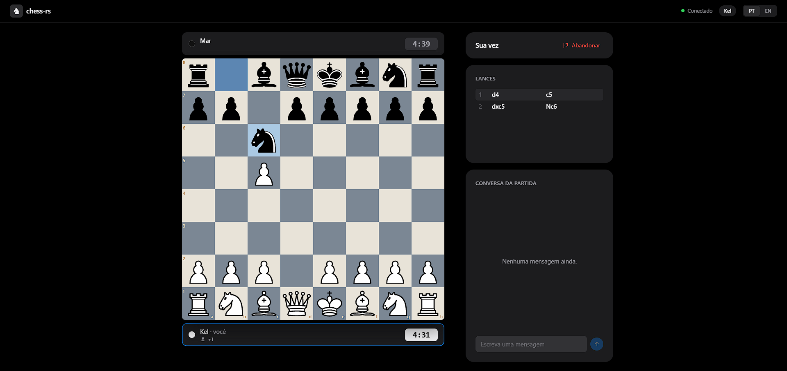
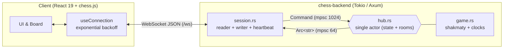
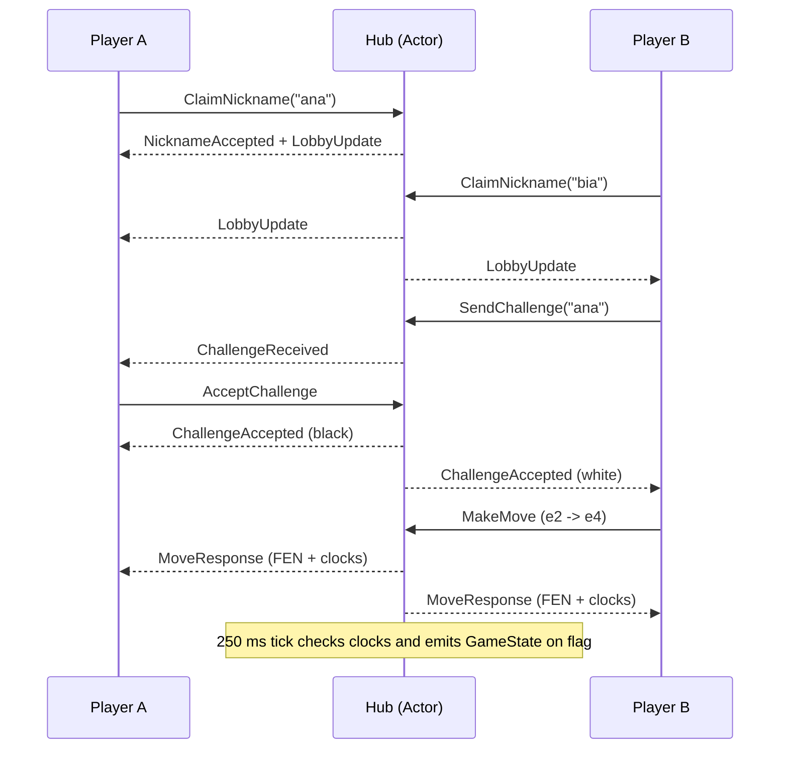

# chess-rs

Real-time multiplayer chess with an authoritative **Rust** server (`axum` + `tokio` + `shakmaty`) and a **React + TypeScript** client.

[Português](README.md) · [English](README.en.md)

[](https://github.com/marcelosoares-dev/chess-rs/actions/workflows/ci.yml)
[](LICENSE)

<!-- Add a screenshot of an active match here, e.g.  -->

---

## Overview

`chess-rs` was built to showcase safe concurrency in Rust, server-authoritative game validation, and a minimal production container setup. Instead of sharing mutable state behind multiple locks, all lobby, challenge, and match state lives inside a single asynchronous Tokio actor.

- **Lobby & matchmaking:** unique case-insensitive nicknames, live online player list, challenge invite/accept/decline flow, and lobby/match chat.
- **Authoritative engine:** full move validation via `shakmaty` (standard UCI castling, *en passant*, optional promotion piece, checkmate and draw detection).
- **Server-owned clocks:** 5-minute per-player clocks ticked on the server at 250 ms resolution; clocks start only after White's first move.
- **Single-binary delivery:** in production, the Rust server serves the compiled frontend assets and handles WebSocket upgrades on the same origin (`/ws`).

---

## Architecture



### Engineering Decisions

1. **Single lock-free actor (`hub.rs`)**
   Lobby state, pending challenges, and active rooms are owned exclusively by the actor task. WebSocket sessions never share `Mutex` or `RwLock` state, eliminating lock-ordering deadlocks and contention. The actor never awaits on network I/O: it serializes each outbound message once into an `Arc<str>` and dispatches it with `try_send`.

2. **Explicit backpressure over unbounded queues (`session.rs`)**
   Each session has a bounded `64`-frame outbox and the actor command channel is bounded to `1024` messages. If a client stalls or stops draining its socket, frames are dropped and logged without affecting other matches or growing process memory.

3. **Pure, deterministic domain (`game.rs`)**
   Chess rules and clock accounting are synchronous and accept `Instant` as an explicit argument. This keeps clock expiration, flagging, and late-move edge cases deterministic and fast to test with zero `sleep` calls.

4. **Authoritative server clock**
   The client renders a smooth local countdown, while the server remains the single source of truth. A `250 ms` actor tick flags expired clocks, and a move arriving after time runs out forfeits on time instead of being played.

5. **Disconnect resilience & frame limits**
   Sessions send heartbeat pings every `15 s` and drop silent connections after `45 s`. Inbound WebSocket frames are capped at `16 KiB`. On clean or abrupt disconnects, the actor tears down the room, returns the opponent to the lobby, and emits `OpponentDisconnected`.

---

## Match Lifecycle



---

## WebSocket Protocol

JSON envelope `{ "type": string, "payload": object }` defined in [protocol.rs](backend/src/protocol.rs) and mirrored in [protocol.ts](frontend/src/protocol.ts).

| Direction | Messages |
| :--- | :--- |
| **Client → Server** | `Ping`, `ClaimNickname`, `ChatMessage`, `SendChallenge`, `AcceptChallenge`, `DeclineChallenge`, `MakeMove` (optional `promotion`), `ResetGame`, `QuitGame` |
| **Server → Client** | `ConnectionEstablished`, `Pong`, `NicknameAccepted`, `NicknameRejected`, `LobbyUpdate`, `ChallengeReceived`, `ChallengeDeclined`, `ChallengeAccepted`, `MoveResponse`, `GameState`, `GameExited`, `OpponentDisconnected`, `ChatMessageEcho`, `Error` |

---

## Running

### Production (Docker — single command)

```bash
docker compose up --build
```

Open `http://localhost:8080`. The multi-stage build compiles the frontend with Node 22, caches Rust dependencies with `cargo-chef`, and produces a non-root `distroless/cc` image running with a `read_only` root filesystem, `cap_drop: [ALL]`, and a native `HEALTHCHECK` against `/health`.

### Development (Hot Reload)

```bash
make dev
```

Starts Vite at `http://localhost:5173` (proxying `/ws` and `/health`) alongside the backend running under `cargo-watch` on `:8080`.

### Native (without Docker)

```bash
# 1. Build the frontend
npm --prefix frontend ci && npm --prefix frontend run build

# 2. Run the backend serving the static bundle
STATIC_DIR=frontend/dist cargo run --manifest-path backend/Cargo.toml
```

### Environment Variables

| Variable | Default | Description |
| :--- | :--- | :--- |
| `BIND_ADDR` | `0.0.0.0:8080` | HTTP/WebSocket listen address |
| `STATIC_DIR` | _(unset)_ | Built frontend directory served as SPA fallback |
| `RUST_LOG` | `info` | `tracing-subscriber` log filter |

---

## Quality & Testing

```bash
make check
```

Runs the full local verification suite:
- `cargo fmt --check` and `cargo clippy --all-targets -- -D warnings`
- `cargo test` (`15` unit tests for protocol & domain + `4` end-to-end WebSocket integration tests)
- `npm run lint` (ESLint + strict TypeScript) and `npm run build`

The workflow in [.github/workflows/ci.yml](.github/workflows/ci.yml) runs the same checks and verifies the Docker image build on every push and pull request.

---

## Repository Layout

```text
.
├── backend/
│   ├── src/
│   │   ├── config.rs      # Environment configuration
│   │   ├── protocol.rs    # Typed WebSocket contract (serde)
│   │   ├── game.rs        # Chess rules, clocks, and flagging
│   │   ├── hub.rs         # Single actor: lobby, challenges, and rooms
│   │   ├── session.rs     # WebSocket lifecycle and heartbeat
│   │   ├── server.rs      # Axum router (/health, /ws, static files)
│   │   └── main.rs        # Entrypoint, healthcheck probe, graceful shutdown
│   └── tests/
│       └── match_flow.rs  # Real WebSocket integration tests
├── frontend/
│   └── src/
│       ├── components/    # Board, MatchView, Lobby, Welcome, Chat, Header, Dialog, Toast
│       ├── hooks/         # useConnection (exponential backoff reconnect)
│       ├── lib/           # Domain helpers built on chess.js
│       ├── state/         # Central reducer with optimistic rollback
│       ├── i18n.ts        # PT / EN dictionary
│       └── index.css      # Token-based design system (8 px grid)
├── Dockerfile             # Multi-stage build (Node -> cargo-chef -> distroless)
├── docker-compose.yml     # Hardened production stack
├── docker-compose.dev.yml # Hot-reload development stack
└── Makefile               # up, down, dev, check, clean targets
```

---

## License

Licensed under the [MIT](LICENSE) license.
