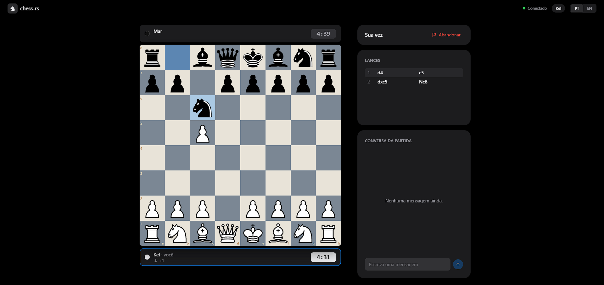
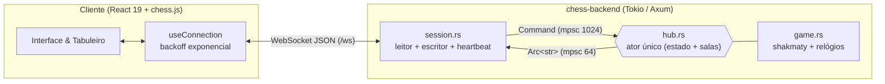
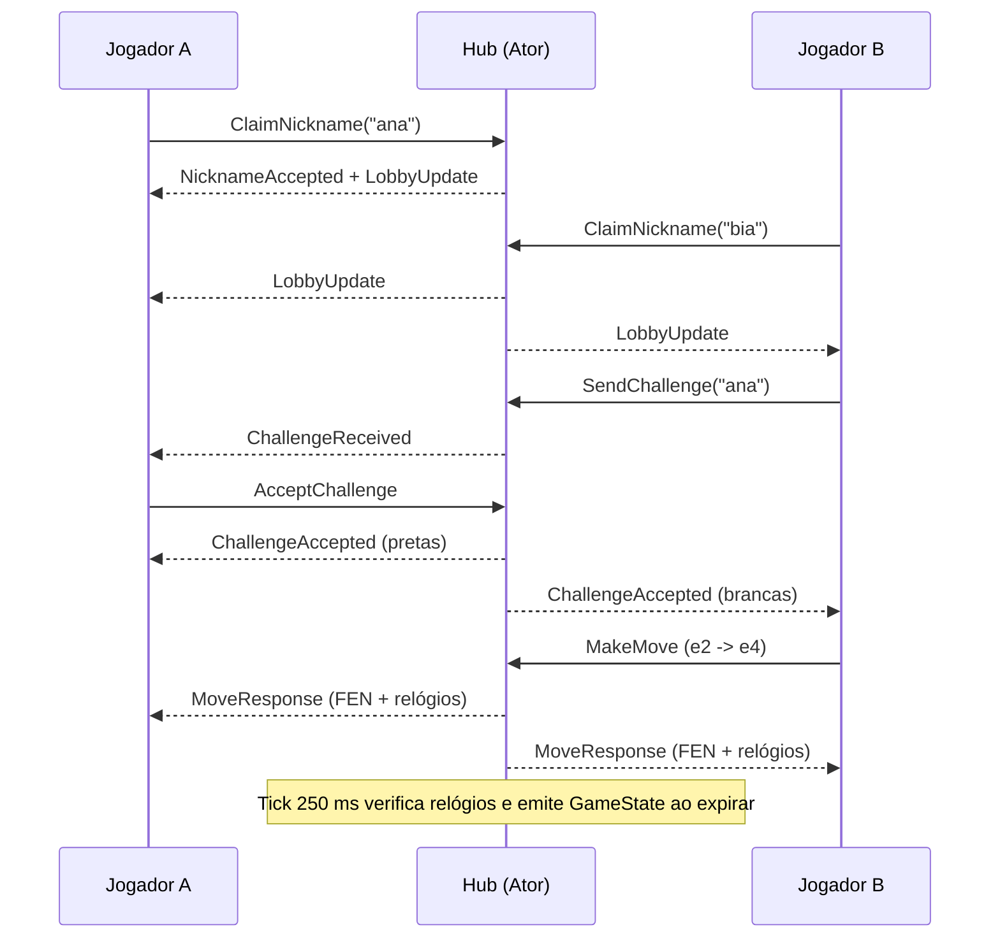

# chess-rs

Xadrez multiplayer em tempo real com servidor autoritativo em **Rust** (`axum` + `tokio` + `shakmaty`) e cliente em **React + TypeScript**.

[Português](README.md) · [English](README.en.md)

[](https://github.com/marcelosoares-dev/chess-rs/actions/workflows/ci.yml)
[](LICENSE)

<!-- Adicione aqui uma captura de tela da partida ativa, ex.:  -->

---

## Visão Geral

O `chess-rs` foi projetado para demonstrar concorrência segura em Rust, validação autoritativa de regras no servidor e entrega de produção em container mínimo. Em vez de compartilhar estado mutável atrás de múltiplos locks, todo o estado de saguão, desafios e partidas vive isolado dentro de um único ator assíncrono no Tokio.

- **Saguão e pareamento:** entrada com nickname único (case-insensitive), lista de jogadores online em tempo real, envio/recusa/aceite de desafios e chat de saguão e de partida.
- **Motor autoritativo:** validação completa de lances via `shakmaty` (roque padrão UCI, *en passant*, promoção com escolha opcional e detecção de xeque-mate/empates).
- **Relógio no servidor:** controle de tempo de 5 minutos por jogador gerenciado no backend com resolução de 250 ms; o relógio só inicia após o primeiro lance das brancas.
- **Entrega em binário único:** em produção, o próprio servidor Rust serve os arquivos estáticos compilados do frontend e faz o upgrade de WebSocket na mesma origem (`/ws`).

---

## Arquitetura



### Decisões de Engenharia

1. **Ator único sem locks (`hub.rs`)**
   Saguão, desafios pendentes e salas ativas pertencem exclusivamente à task do ator. As conexões WebSocket não acessam estado compartilhado com `Mutex` ou `RwLock`, eliminando deadlocks por ordem de locks e contenção entre leitores e escritores. O ator nunca faz `.await` em I/O de rede: apenas serializa cada mensagem uma única vez em `Arc<str>` e envia via `try_send`.

2. **Backpressure explícito em vez de filas infinitas (`session.rs`)**
   Cada sessão possui uma caixa de saída limitada a `64` quadros e a fila de entrada do ator é limitada a `1024` comandos. Se um cliente ficar lento ou parar de drenar o socket, o servidor descarta quadros excedentes e registra o evento em log, protegendo a latência das demais partidas e a memória do processo.

3. **Domínio puro e determinístico (`game.rs`)**
   A lógica de xadrez e relógios é síncrona e recebe `Instant` explicitamente como parâmetro. Isso permite testar transições de tempo, bandeira e lances atrasados de forma determinística e instantânea, sem `sleep` nos testes.

4. **Relógio autoritativo no servidor**
   O cliente exibe uma contagem regressiva fluida localmente, mas apenas o servidor decide quando o tempo acabou. Um tick de `250 ms` no ator verifica partidas expiradas e um lance que chega após o estouro do relógio perde por tempo em vez de ser aplicado.

5. **Resiliência de rede e limites de frame**
   Cada sessão envia pings de heartbeat a cada `15 s` e encerra conexões silenciosas após `45 s` sem atividade. Quadros recebidos são limitados a `16 KiB`. Em desconexões limpas ou abruptas, o ator remove a sala, devolve o oponente ao saguão e notifica com `OpponentDisconnected`.

---

## Ciclo de uma Partida



---

## Protocolo WebSocket

Envelope JSON `{ "type": string, "payload": object }` definido em [protocol.rs](backend/src/protocol.rs) e espelhado em [protocol.ts](frontend/src/protocol.ts).

| Direção | Mensagens |
| :--- | :--- |
| **Cliente → Servidor** | `Ping`, `ClaimNickname`, `ChatMessage`, `SendChallenge`, `AcceptChallenge`, `DeclineChallenge`, `MakeMove` (`promotion` opcional), `ResetGame`, `QuitGame` |
| **Servidor → Cliente** | `ConnectionEstablished`, `Pong`, `NicknameAccepted`, `NicknameRejected`, `LobbyUpdate`, `ChallengeReceived`, `ChallengeDeclined`, `ChallengeAccepted`, `MoveResponse`, `GameState`, `GameExited`, `OpponentDisconnected`, `ChatMessageEcho`, `Error` |

---

## Como Executar

### Produção (Docker — comando único)

```bash
docker compose up --build
```

Acesse `http://localhost:8080`. O build multi-stage compila o frontend com Node 22, cacheia as dependências Rust com `cargo-chef` e gera uma imagem final `distroless/cc` não-root, com sistema de arquivos `read_only`, `cap_drop: [ALL]` e `HEALTHCHECK` nativo via `/health`.

### Desenvolvimento com Hot Reload

```bash
make dev
```

Sobe o Vite em `http://localhost:5173` (com proxy para `/ws` e `/health`) e o backend com `cargo-watch` em `:8080`.

### Execução Nativa (sem Docker)

```bash
# 1. Compilar o frontend
npm --prefix frontend ci && npm --prefix frontend run build

# 2. Subir o servidor servindo o build estático
STATIC_DIR=frontend/dist cargo run --manifest-path backend/Cargo.toml
```

### Variáveis de Ambiente

| Variável | Padrão | Descrição |
| :--- | :--- | :--- |
| `BIND_ADDR` | `0.0.0.0:8080` | Endereço e porta de escuta HTTP/WebSocket |
| `STATIC_DIR` | _(vazio)_ | Diretório de arquivos estáticos servido em fallback SPA |
| `RUST_LOG` | `info` | Nível de log do `tracing-subscriber` |

---

## Qualidade e Testes

```bash
make check
```

Executa toda a esteira de verificação local:
- `cargo fmt --check` e `cargo clippy --all-targets -- -D warnings`
- `cargo test` (`15` testes unitários de protocolo e domínio + `4` testes de integração WebSocket ponta a ponta)
- `npm run lint` (ESLint + TypeScript estrito) e `npm run build`

O workflow em [.github/workflows/ci.yml](.github/workflows/ci.yml) executa as mesmas validações e verifica o build da imagem Docker em todo push e pull request.

---

## Estrutura do Repositório

```text
.
├── backend/
│   ├── src/
│   │   ├── config.rs      # Leitura de variáveis de ambiente
│   │   ├── protocol.rs    # Contrato WebSocket tipado (serde)
│   │   ├── game.rs        # Regras de xadrez, relógios e bandeira
│   │   ├── hub.rs         # Ator único: saguão, desafios e salas
│   │   ├── session.rs     # Ciclo de vida do WebSocket e heartbeat
│   │   ├── server.rs      # Rotas Axum (/health, /ws, estáticos)
│   │   └── main.rs        # Bootstrap, probe de healthcheck e shutdown gracioso
│   └── tests/
│       └── match_flow.rs  # Testes de integração via WebSocket real
├── frontend/
│   └── src/
│       ├── components/    # Board, MatchView, Lobby, Welcome, Chat, Header, Dialog, Toast
│       ├── hooks/         # useConnection (reconexão com backoff exponencial)
│       ├── lib/           # Helpers de domínio sobre chess.js
│       ├── state/         # Reducer central com rollback otimista
│       ├── i18n.ts        # Dicionário PT / EN
│       └── index.css      # Design system com tokens e grid de 8 px
├── Dockerfile             # Build multi-stage (Node -> cargo-chef -> distroless)
├── docker-compose.yml     # Stack de produção endurecida
├── docker-compose.dev.yml # Stack de desenvolvimento com hot reload
└── Makefile               # Atalhos up, down, dev, check, clean
```

---

## Licença

Distribuído sob a licença [MIT](LICENSE).
